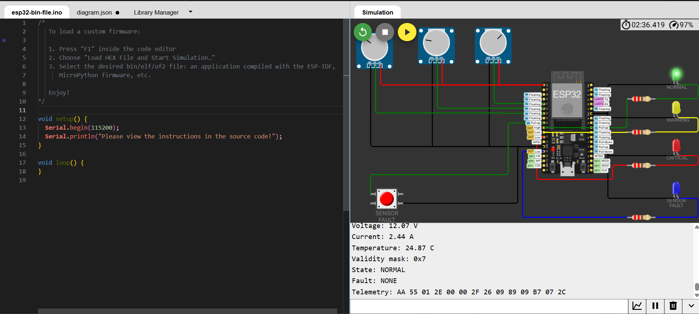

# BatteryGuard

**Embedded Battery Monitoring and Protection Prototype**

BatteryGuard is an embedded C project that monitors simulated battery voltage, current, and temperature, detects abnormal operating conditions, and manages protection states through a shared platform-independent protection engine.

The project runs in two environments:

- **Host simulation:** Builds and tests the core logic on Linux using GCC and CMake.
- **ESP32 simulation:** Runs the same protection engine on an ESP32 in Wokwi, with interactive potentiometers, a fault-injection button, and visual LED indicators.

The project was developed without physical hardware. All ESP32 sensor inputs, fault scenarios, and status indicators were demonstrated through Wokwi.

## Wokwi Demonstration

**Wokwi project:** [Open BatteryGuard simulation](https://wokwi.com/projects/305457271083631168)

The following screenshot shows the ESP32 simulation running in the normal state, with the green status LED illuminated and UART telemetry displayed in the Serial Monitor.



## Features

- Simulated voltage, current, and temperature monitoring.
- Sensor validity checking and invalid measurement handling.
- Protection state management using a finite state machine.
- Warning conditions with hysteresis.
- Critical fault detection and prioritization.
- Fault latching and consecutive-safe-sample recovery.
- Fixed-length binary telemetry frames.
- CRC-8/ATM error detection.
- UART telemetry output.
- Four LED indicators for visual protection-state feedback.
- Shared platform-independent C protection and communication logic.
- Host-side automated unit tests.
- ESP32 firmware simulation using Wokwi.

## Development Environment

The project was developed using the following setup:

| Component | Tool / Version |
|---|---|
| Operating system | Ubuntu 24.04 LTS |
| Linux environment | WSL2 on Windows |
| Code editor | Visual Studio Code |
| C compiler | GCC 13.3 |
| Build system | CMake 3.28 |
| Build utility | GNU Make |
| Embedded framework | Arduino framework for ESP32 |
| Embedded build system | PlatformIO Core 6.2 |
| Simulation | Wokwi ESP32 Simulator |
| Microcontroller | ESP32 |
| PlatformIO board target | `esp32dev` |
| Wokwi board model | ESP32 DevKit C V4 (`board-esp32-devkit-c-v4`) |
| Version control | Git |
| Programming language | C11 and C++ (ESP32 Arduino entry point) |

### VS Code Extensions

The development workflow uses:

- **C/C++ (Microsoft):** C/C++ language support, code navigation, and debugging assistance.
- **PlatformIO IDE:** ESP32 project integration and embedded firmware builds.
- **CMake Tools (Microsoft):** Optional CMake project integration in VS Code.

The host build and test workflow uses the terminal directly, so these extensions are not required to run the project.

## Repository Structure

```text
batteryguard/
│
├── include/
│   ├── battery.h
│   ├── protocol.h
│   └── sensor.h
│
├── src/
│   ├── battery.c
│   ├── main.c
│   ├── protocol.c
│   └── sensor_sim.c
│
├── firmware/
│   └── esp32/
│       └── main.cpp
│
├── tests/
│   ├── test_battery.c
│   └── test_protocol.c
│
├── docs/
│   ├── architecture.md
│   ├── protocol.md
│   └── images/
│       └── batteryguard-wokwi-normal.png
│
├── .vscode/
├── CMakeLists.txt
├── platformio.ini
├── diagram.json
├── wokwi.toml
├── .gitignore
└── README.md
```

For detailed module responsibilities, system flow, protection states, and design decisions, refer to **[Architecture Documentation](docs/architecture.md)**.

For the UART frame structure, field encoding, byte order, validity mask, and CRC-8 implementation, refer to **[Protocol Documentation](docs/protocol.md)**.

## Prerequisites

The following instructions assume Ubuntu 24.04 running through WSL2.

Install the host development tools:

```bash
sudo apt update

sudo apt install -y \
    build-essential \
    gcc \
    g++ \
    cmake \
    make \
    git \
    python3 \
    python3-venv \
    pipx
```

Install PlatformIO Core:

```bash
pipx install platformio
pipx ensurepath
```

Restart the terminal if necessary, then verify the installations:

```bash
gcc --version
cmake --version
make --version
git --version
pio --version
```

The project was developed and verified with GCC 13.3, CMake 3.28, and PlatformIO Core 6.2.

## Clone the Repository

Clone the repository and enter its directory:

```bash
git clone https://github.com/sahilf7/batteryguard.git

cd batteryguard
```

If you are using a different GitHub repository URL, replace the URL above accordingly.

## 1. Build and Run the Host Simulation

The host simulation allows the protection engine to run independently of the ESP32 hardware environment.

### Configure the CMake project

```bash
cmake -S . -B build
```

This generates the build files inside the `build/` directory.

### Compile the project

```bash
cmake --build build
```

This builds the host executable and the automated test executables.

### Run the host simulation

```bash
./build/batteryguard_host
```

The terminal displays simulated battery measurements, protection states, detected faults, and encoded telemetry frames.

The host simulation uses predefined sensor scenarios to demonstrate normal operation, warning conditions, critical faults, and recovery.

## 2. Run the Automated Tests

BatteryGuard includes separate automated test suites for the protection engine and telemetry protocol.

Run both test suites using CTest:

```bash
ctest --test-dir build --output-on-failure
```

Expected result:

```text
100% tests passed, 0 tests failed out of 2
```

The two test executables contain:

- 20 battery protection tests.
- 10 telemetry protocol tests.

To execute the test programs individually:

```bash
./build/batteryguard_tests
```

```bash
./build/batteryguard_protocol_tests
```

The tests cover protection behavior, sensor validation, fault handling, recovery, telemetry encoding, and CRC-8 verification.

## 3. Build the ESP32 Firmware

PlatformIO compiles the ESP32 firmware using the same shared protection and protocol source files used by the host simulation.

From the repository root, run:

```bash
pio run -e esp32dev
```

After a successful build, the generated firmware files are located at:

```text
.pio/build/esp32dev/firmware.bin
.pio/build/esp32dev/firmware.elf
```

The `.bin` file is used to run the simulation in the Wokwi browser.

The `.elf` file contains additional debugging information.

**Important:** The ESP32 firmware does not contain a separate implementation of the battery protection logic. PlatformIO compiles the shared `src/battery.c` and `src/protocol.c` files together with the ESP32-specific entry point in `firmware/esp32/main.cpp`.

## 4. Run the ESP32 Simulation in Wokwi

The ESP32 demonstration uses the Wokwi browser simulator. No physical ESP32 board or sensors are required.

**Simulated board:** ESP32 DevKit C V4

**PlatformIO target:** `esp32dev`

**Framework:** Arduino

### Step 1: Open the Wokwi project

Open the project:

[BatteryGuard on Wokwi](https://wokwi.com/projects/305457271083631168)

### Step 2: Load the circuit diagram

The repository contains the circuit configuration in:

```text
diagram.json
```

This file describes the ESP32 board, three potentiometers, the sensor fault button, four status LEDs, their current-limiting resistors, and the UART Serial Monitor connections.

Use the contents of this file in the Wokwi project's diagram editor.

### Step 3: Upload the compiled firmware

First, make sure the ESP32 firmware has been built:

```bash
pio run -e esp32dev
```

Locate the generated binary:

```text
.pio/build/esp32dev/firmware.bin
```

In the Wokwi browser:

1. Open the BatteryGuard project.
2. Open the command menu using `F1`.
3. Select **Upload Firmware and Start Simulation**.
4. Select the generated `firmware.bin` file.
5. Start the simulation.

The ESP32 now executes the compiled BatteryGuard firmware using the circuit defined in `diagram.json`.

### Step 4: Open the Serial Monitor

The firmware communicates through UART at:

```text
Baud rate: 115200
```

The Serial Monitor displays the measured values, validity mask, protection state, detected fault, and encoded telemetry frame.

### Step 5: Interact with the simulation

The circuit provides three potentiometers, one pushbutton, and four status LEDs.

**Simulated input components**

| Component | ESP32 GPIO | Purpose |
|---|---:|---|
| Voltage potentiometer | GPIO 34 | Simulates battery voltage |
| Current potentiometer | GPIO 35 | Simulates battery current |
| Temperature potentiometer | GPIO 32 | Simulates battery temperature |
| Sensor fault button | GPIO 25 | Injects a sensor validity fault |

**Status LED indicators**

| LED | ESP32 GPIO | Indication |
|---|---:|---|
| Green | GPIO 26 | Normal operation |
| Yellow | GPIO 27 | Warning condition |
| Red | GPIO 14 | Critical fault |
| Blue | GPIO 13 | Sensor fault |

Each LED uses an individual 220 Ω current-limiting resistor. The LEDs are active-high outputs, with their cathodes connected to ESP32 GND.

**Demonstration scenarios**

Use the potentiometers and pushbutton to demonstrate:

| Scenario | Input condition | Expected LED |
|---|---|---|
| Normal operation | All measurements within normal ranges | Green |
| Warning | A measurement crosses its warning threshold | Yellow |
| Critical fault | A measurement crosses its critical threshold | Red |
| Sensor fault | Hold the fault button long enough to trigger sensor fault detection | Blue |
| Recovery | Release the button or restore safe measurements and maintain safe conditions for the required recovery samples | Green |

The potentiometers simulate analog sensor measurements. The pushbutton forces the sensor validity mask to zero while pressed.

The sensor fault is detected after three consecutive invalid samples. With a 500 ms sampling interval, this takes approximately 1.5 seconds.

Critical faults remain latched until the configured recovery conditions are satisfied. Recovery requires three consecutive safe measurement samples.

The Serial Monitor displays the corresponding measurement values, protection states, fault information, and telemetry frames.

**Note:** The LEDs provide visual status indication only. They do not perform electrical battery protection or physically disconnect a battery or load.

## 5. Useful Development Commands

All commands below should be executed from the repository root.

| Task | Command |
|---|---|
| Configure host build | `cmake -S . -B build` |
| Compile host project | `cmake --build build` |
| Run host simulation | `./build/batteryguard_host` |
| Run all tests | `ctest --test-dir build --output-on-failure` |
| Run battery tests | `./build/batteryguard_tests` |
| Run protocol tests | `./build/batteryguard_protocol_tests` |
| Build ESP32 firmware | `pio run -e esp32dev` |
| Clean CMake build | `cmake --build build --target clean` |
| Clean PlatformIO build | `pio run -e esp32dev -t clean` |
| Check Git changes | `git status` |

## Project Documentation

The README provides the setup and execution workflow. Detailed technical explanations are maintained separately:

- [Architecture Documentation](docs/architecture.md)
- [Telemetry Protocol Documentation](docs/protocol.md)

## Limitations

BatteryGuard is an educational embedded software prototype demonstrated using host-side execution and ESP32 simulation.

- No physical battery or protection circuit was tested.
- Sensor values are simulated through Wokwi potentiometers.
- The project does not implement a physical battery disconnect circuit.
- Protection thresholds are prototype values, not validated battery-chemistry safety limits.
- ADC readings are simulated and are not calibrated against real sensors.
- LEDs provide visual indication only and do not perform electrical protection.
- The prototype is not intended for use as a real battery management or safety system.

## Project Status

- [x] Project structure and build environment.
- [x] Platform-independent battery protection engine.
- [x] Host simulation.
- [x] Sensor validation and fault recovery.
- [x] UART telemetry frame and CRC-8.
- [x] Automated host-side tests.
- [x] ESP32 firmware integration.
- [x] Wokwi circuit and interactive simulation.
- [x] Normal, warning, fault, and recovery demonstrations.
- [x] LED-based protection-state indication.
- [x] Project documentation.

---

**BatteryGuard | Embedded C | ESP32 | PlatformIO | CMake | Wokwi**